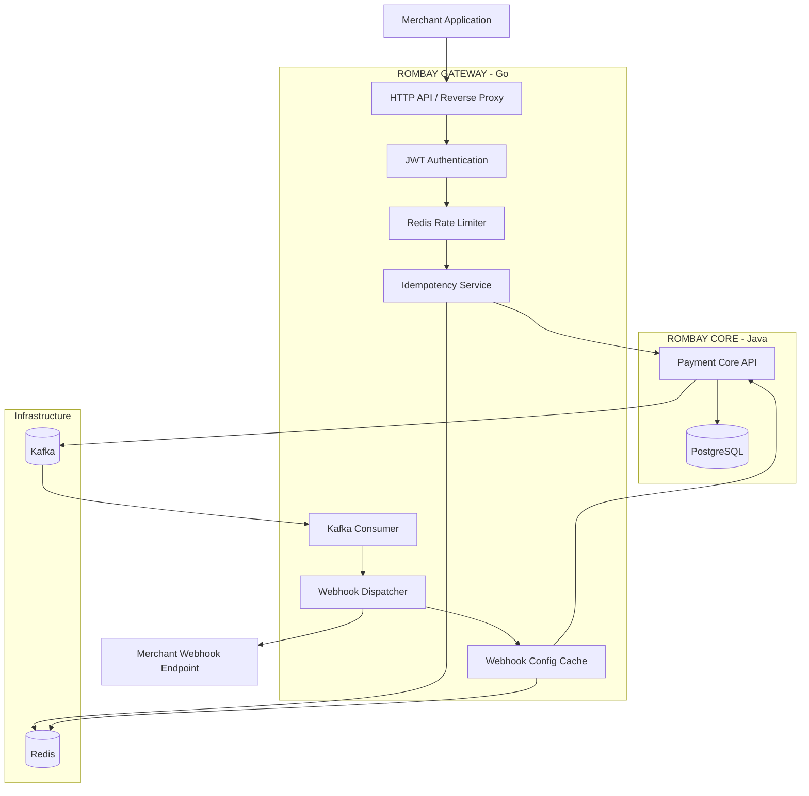

# Rombay Gateway

**The secure entry point for the Rombay payment platform.**

## Implementation status

Phase 1 is implemented. The process loads configuration, writes structured logs, serves `GET /healthz` and `GET /readyz`, and shuts down on `SIGINT` or `SIGTERM`. `/readyz` stays `DOWN` until Redis and Kafka both answer. Payment routes, JWT validation, rate limiting, the core proxy, and webhook delivery are not implemented yet.

`rombay-gateway` is the API gateway for the Rombay payment platform. It acts as the single entry point for merchant applications, handling authentication, rate limiting, request idempotency, and request forwarding to [`rombay-core`](https://github.com/rombay-tbk/rombay-core).

It also handles asynchronous payment status notifications through a webhook delivery system powered by Kafka, with HMAC signature verification, automatic retries, and dead-letter handling.

## Table of Contents

- [Overview](#overview)
- [Architecture](#architecture)
- [Responsibilities](#responsibilities)
- [Technology Stack](#technology-stack)
- [Project Structure](#project-structure)
- [Getting Started](#getting-started)
- [Configuration](#configuration)
- [API Endpoints](#api-endpoints)
- [Request Lifecycle](#request-lifecycle)
- [Idempotency](#idempotency)
- [Webhook Delivery](#webhook-delivery)
- [Security Considerations](#security-considerations)
- [Observability](#observability)
- [Testing](#testing)
- [Docker](#docker)
- [CI/CD](#cicd)
- [Development Roadmap](#development-roadmap)
- [Related Projects](#related-projects)
- [License](#license)

---

## Overview

Rombay Gateway is responsible for managing communication between merchants and the Rombay payment core.

Instead of allowing merchant applications to communicate directly with the core service, all public API requests pass through the gateway first.

The gateway provides:

- JWT-based merchant authentication.
- Per-merchant rate limiting using Redis.
- Idempotent payment creation to prevent duplicate transactions.
- Reverse proxying to the internal payment core.
- Asynchronous webhook delivery for payment status changes.
- HMAC-SHA256 webhook signatures.
- Automatic retry scheduling and dead-letter handling.
- Prometheus metrics and structured logging.

### Design Principles

The gateway follows several architectural principles:

1. **Single Entry Point** — All merchant-facing API traffic goes through the gateway.
2. **Stateless Application** — Gateway instances do not depend on local application state.
3. **Core as Source of Truth** — Transaction, account, balance, and ledger data remain exclusively managed by the core.
4. **Fail Safely** — Authentication, rate limiting, and idempotency failures must not silently bypass security controls.
5. **Asynchronous Delivery** — Webhook delivery must not block synchronous payment API responses.
6. **Horizontal Scalability** — Multiple gateway instances can operate using shared infrastructure.

## Architecture

### High-Level Architecture



### Request Flow

**Synchronous Payment Flow**

```text
Merchant
   |
   | POST /payments
   | Authorization: Bearer <JWT>
   | Idempotency-Key: <KEY>
   |
   v
Rombay Gateway
   |
   +--> JWT Authentication
   |
   +--> Rate Limiting (Redis)
   |
   +--> Idempotency Validation
   |
   +--> Reverse Proxy
   |
   v
Rombay Core
   |
   +--> Validate Payment
   +--> Process Transaction
   +--> Persist Transaction
   +--> Publish Payment Event
   |
   v
Gateway
   |
   v
Merchant Response
```

**Asynchronous Webhook Flow**

```text
Rombay Core
   |
   | Payment Status Changed
   v
Kafka
   |
   v
Gateway Consumer
   |
   v
Durable Webhook Job Store
   |
   v
Webhook Worker Pool
   |
   +--> Load Merchant Webhook Configuration
   +--> Generate HMAC Signature
   +--> Deliver HTTP POST
   |
   +--> Success (2xx)
   |
   +--> Failure
          |
          v
      Retry Scheduler
          |
          +--> Retry
          |
          +--> Dead-Letter Queue
```

## Responsibilities

### In Scope

| Component | Responsibility |
|---|---|
| Authentication | Validate merchant JWT tokens |
| Rate Limiting | Enforce per-merchant request limits |
| Idempotency | Prevent duplicate payment requests |
| Reverse Proxy | Forward validated requests to Rombay Core |
| Kafka Consumer | Consume payment status events |
| Webhook Dispatcher | Deliver payment notifications |
| Retry Scheduler | Schedule failed webhook deliveries |
| Dead-Letter Queue | Store events that exhaust retry attempts |
| Observability | Expose metrics and structured logs |

### Out of Scope

The gateway does not own payment business logic or financial records.

| Responsibility | Owner |
|---|---|
| Account management | Rombay Core |
| Payment processing | Rombay Core |
| Transaction persistence | Rombay Core |
| Balance management | Rombay Core |
| Double-entry bookkeeping | Rombay Ledger |
| Financial reconciliation | Rombay Ledger / Core |
| Merchant business logic | Merchant Application |

The gateway must never become the source of truth for financial transactions or account balances.

## Technology Stack

| Component | Technology |
|---|---|
| Language | Go 1.23+ |
| HTTP Server | Go `net/http` |
| Routing | Go `ServeMux` |
| Authentication | `golang-jwt/jwt/v5` |
| Cache / Rate Limiting | Redis |
| Messaging | Apache Kafka |
| Kafka Client | `segmentio/kafka-go` |
| Reverse Proxy | `net/http/httputil` |
| Metrics | Prometheus |
| Logging | `log/slog` |
| Testing | Go `testing` |
| Containerization | Docker |
| CI/CD | GitHub Actions |

## Project Structure

```text
rombay-gateway/
├── cmd/
│   └── gateway/
│       └── main.go
│
├── internal/
│   ├── config/
│   │   └── config.go
│   │
│   ├── auth/
│   │   └── jwt.go
│   │
│   ├── middleware/
│   │   ├── auth.go
│   │   ├── ratelimit.go
│   │   ├── idempotency.go
│   │   ├── logging.go
│   │   └── requestid.go
│   │
│   ├── idempotency/
│   │   └── service.go
│   │
│   ├── proxy/
│   │   └── proxy.go
│   │
│   ├── webhook/
│   │   ├── dispatcher.go
│   │   ├── worker.go
│   │   ├── signer.go
│   │   ├── retry.go
│   │   └── config.go
│   │
│   ├── consumer/
│   │   └── payment_consumer.go
│   │
│   └── infrastructure/
│       ├── redis.go
│       └── kafka.go
│
├── docs/
│   ├── architecture.md
│   ├── api.md
│   ├── idempotency.md
│   ├── webhook.md
│   └── operations.md
│
├── .github/
│   └── workflows/
│       └── ci.yml
│
├── Dockerfile
├── go.mod
├── go.sum
├── .gitignore
└── README.md
```

## Getting Started

Phase 1 talks only to Redis and Kafka. `rombay-core` is not called yet. Core keeps its own Compose file for PostgreSQL and the core process.

### Prerequisites

- Go 1.23 or newer.
- Docker, when you want the local Redis and Kafka in `compose.yaml`.

### Start Redis and Kafka

Core Compose creates the Docker network `rombay-net`. Create it once if core is not running:

```bash
docker network create rombay-net
```

From this repository:

```bash
docker compose up -d
```

Redis is published on `localhost:6379`. Kafka is published on `localhost:9092`. Redis uses AOF with `appendfsync everysec` and `maxmemory-policy noeviction`. A crash can drop about one second of writes. When memory is full, Redis refuses writes instead of evicting keys. That is the accepted durability limit for later idempotency state and webhook jobs. Webhook delivery remains at-least-once.

### Configure and run

```bash
export HTTP_PORT=8080
export REDIS_ADDR=localhost:6379
export KAFKA_BROKERS=localhost:9092

go run ./cmd/gateway
```

See `.env.example` for every variable. The process reads the environment. It does not load a `.env` file.

The gateway listens on:

```text
http://localhost:8080
```

### Verify liveness and readiness

Liveness does not call Redis or Kafka:

```bash
curl -i http://localhost:8080/healthz
```

```json
{"status":"UP"}
```

Readiness returns `200` only when both dependencies answer, and `503` otherwise:

```bash
curl -i http://localhost:8080/readyz
```

```json
{"status":"UP","checks":{"kafka":{"status":"UP"},"redis":{"status":"UP"}}}
```

Stop the process with Ctrl+C. It drains HTTP connections, then closes the Redis pool and idle Kafka connections.

## Configuration

| Variable | Required | Default | Description |
|---|---|---|---|
| `HTTP_PORT` | No | `8080` | HTTP server port |
| `LOG_LEVEL` | No | `info` | `debug`, `info`, `warn`, or `error` |
| `SHUTDOWN_TIMEOUT` | No | `15s` | Graceful shutdown budget |
| `DEPENDENCY_TIMEOUT` | No | `2s` | Timeout for each readiness check and for dialing Redis or Kafka |
| `REDIS_ADDR` | Yes | - | Redis host and port |
| `REDIS_PASSWORD` | No | empty | Redis AUTH password |
| `KAFKA_BROKERS` | Yes | - | Comma-separated Kafka brokers |
| `KAFKA_CLIENT_ID` | No | `rombay-gateway` | Kafka client id |

`CORE_URL` and `JWT_SECRET` are not read in Phase 1. They belong to the core proxy and JWT validation, which are later phases.

Additional configuration may be introduced as the project evolves, including:

- Redis password and TLS.
- Kafka authentication and TLS.
- HTTP client timeout.
- Rate limit policy.
- Idempotency TTL.
- Webhook worker concurrency.
- Webhook retry configuration.
- Webhook configuration cache TTL.

## API Endpoints

All merchant-facing endpoints require a valid JWT token unless explicitly documented otherwise.

### Public Endpoints

| Method | Endpoint | Authentication | Description |
|---|---|---|---|
| `POST` | `/payments` | Required | Create a payment |
| `GET` | `/payments/{id}` | Required | Retrieve payment status |
| `GET` | `/healthz` | Not required | Application health |
| `GET` | `/metrics` | Restricted | Prometheus metrics |

### Create Payment

```http
POST /payments
Authorization: Bearer <token>
Idempotency-Key: ord-20261026-0042
Content-Type: application/json
```

Example request:

```json
{
  "from_account": "ACC-001",
  "to_account": "ACC-002",
  "amount": 150000,
  "currency": "IDR",
  "reference": "ORDER-0042"
}
```

Example cURL:

```bash
curl -X POST http://localhost:8080/payments \
  -H "Authorization: Bearer <token>" \
  -H "Idempotency-Key: ord-20261026-0042" \
  -H "Content-Type: application/json" \
  -d '{
    "from_account": "ACC-001",
    "to_account": "ACC-002",
    "amount": 150000,
    "currency": "IDR",
    "reference": "ORDER-0042"
  }'
```

### Retrieve Payment

```http
GET /payments/{id}
Authorization: Bearer <token>
```

Example:

```bash
curl http://localhost:8080/payments/PAY-001 \
  -H "Authorization: Bearer <token>"
```

### API Contract

The complete API schema, request validation, response format, and error definitions are maintained in the main Rombay repository:

- [`docs/openapi.yaml`](https://github.com/<username>/rombay/blob/main/docs/openapi.yaml)

The gateway must follow the canonical API contract rather than independently redefining merchant-facing request and response schemas.

## Request Lifecycle

Every merchant payment request follows this sequence:

1. Generate or validate a request ID.
2. Validate JWT signature and claims.
3. Extract the authenticated merchant identity.
4. Apply the merchant's rate limit.
5. Validate the `Idempotency-Key`.
6. Calculate the request fingerprint.
7. Atomically reserve or retrieve the idempotency record.
8. Forward the request to Rombay Core.
9. Store the resulting HTTP status and response.
10. Return the response to the merchant.

The authenticated merchant identity must be derived from verified JWT claims, never from untrusted request headers or body fields.

## Idempotency

The gateway uses Redis to coordinate idempotency across multiple gateway instances.

### Key Format

```text
idempotency:{merchant_id}:{idempotency_key}
```

Example:

```text
idempotency:MERCHANT-001:order-001
```

### Idempotency Behavior

| Scenario | Expected Behavior |
|---|---|
| New key | Reserve and process the request |
| Same key + same payload | Return the original result when completed |
| Same key + different payload | Reject with `422 Unprocessable Entity` |
| Same key + request still processing | Return a documented in-progress response |
| Redis unavailable | Fail closed; do not bypass idempotency |

### State Lifecycle

```text
NEW
 |
 v
PENDING
 |
 +----> COMPLETED
 |
 +----> FAILED / RECOVERABLE
```

The implementation must use atomic Redis operations for reservation and state transitions.

A request timeout does not necessarily mean the core transaction failed. Therefore, the gateway must propagate the same idempotency key to the core.

**Important:** Core-side idempotency is mandatory for payment creation. Gateway-side idempotency alone cannot guarantee that duplicate financial transactions will never occur.

Additional implementation requirements:

- Atomic reservation using Redis Lua scripts.
- Compare-and-set completion.
- Recovery for stale PENDING records.
- Explicit expiration and retention policies.
- Consistent fingerprint generation.
- Concurrent request handling.
- Core-side unique idempotency constraint.

## Webhook Delivery

The gateway delivers asynchronous payment status notifications to merchant endpoints.

### Webhook Configuration

Webhook configuration is retrieved from Rombay Core:

```http
GET /internal/merchants/{merchant_id}/webhook-config
```

Example response:

```json
{
  "url": "https://merchant.com/webhooks/rombay",
  "secret": "<merchant-webhook-secret>"
}
```

The configuration is cached temporarily to reduce unnecessary internal API requests.

Recommended initial cache TTL: 5 minutes.

### Webhook Payload

The exact webhook event schema must follow the canonical event contract maintained by Rombay.

Illustrative payload:

```json
{
  "event_id": "EVT-001",
  "event_type": "payment.success",
  "merchant_id": "MERCHANT-001",
  "payment_id": "PAY-001",
  "status": "SUCCESS",
  "amount": 150000,
  "currency": "IDR"
}
```

### Signature Verification

Every webhook request contains:

```http
X-Rombay-Signature: sha256=<hmac>
```

The signature is calculated using HMAC-SHA256:

```text
HMAC-SHA256(raw_request_body, merchant_webhook_secret)
```

Merchants must verify the signature using the original raw request body and a constant-time comparison.

Example Go verification:

```go
func Verify(
    body []byte,
    secret string,
    signature string,
) bool {
    mac := hmac.New(sha256.New, []byte(secret))
    mac.Write(body)

    expected := "sha256=" +
        hex.EncodeToString(mac.Sum(nil))

    return hmac.Equal(
        []byte(expected),
        []byte(signature),
    )
}
```

### Retry Policy

Webhook delivery is considered successful only when the merchant endpoint returns an HTTP 2xx response.

| Attempt | Retry Delay |
|---|---|
| Initial delivery | Immediately |
| Retry 1 | 1 minute |
| Retry 2 | 5 minutes |
| Retry 3 | 30 minutes |
| Retry 4 | 2 hours |
| Final failure | Dead-letter queue |

Retry scheduling must be handled asynchronously without blocking Kafka consumers or worker threads.

### Dead-Letter Queue

Events that exhaust all retry attempts are moved to a durable dead-letter queue.

DLQ records should contain:

- Event ID.
- Merchant ID.
- Payment ID.
- Original payload.
- Destination URL or configuration reference.
- Last HTTP response status.
- Last error message.
- Number of attempts.
- First and last delivery timestamps.
- Failure classification.

DLQ events must support operational inspection and controlled replay.

### Delivery Semantics

Webhook delivery follows an **at-least-once delivery model**.

This means merchants must support duplicate event delivery and deduplicate using `event_id`.

The gateway should not claim exactly-once webhook delivery over HTTP.

## Security Considerations

Security is a core requirement for a payment gateway.

### Authentication

- Validate JWT signature, issuer, audience, and expiration.
- Restrict accepted signing algorithms.
- Support key rotation.
- Never trust merchant identity supplied through public request headers.
- Avoid logging access tokens.

### Network Security

- Expose only merchant-facing gateway endpoints.
- Keep core service endpoints on an internal network.
- Use TLS for external communication.
- Restrict internal service-to-service access.

### Webhook Security

- Use HMAC-SHA256 signatures.
- Protect merchant webhook secrets.
- Validate destination URLs.
- Block localhost, private, link-local, and restricted IP ranges.
- Protect against DNS rebinding and redirect-based SSRF.
- Set outbound request timeouts.
- Never follow arbitrary redirects.

### Idempotency Security

- Scope keys by merchant ID.
- Validate payload fingerprints.
- Use atomic Redis operations.
- Never bypass idempotency when Redis is unavailable.

## Observability

The gateway exposes Prometheus metrics for monitoring request behavior, infrastructure health, and webhook delivery performance.

### Recommended Metrics

| Metric | Description |
|---|---|
| `gateway_requests_total` | Total incoming requests |
| `gateway_request_duration_seconds` | Request latency |
| `gateway_request_errors_total` | Failed requests |
| `gateway_idempotency_replays_total` | Replayed requests |
| `gateway_rate_limit_rejected_total` | Rate-limited requests |
| `gateway_webhook_deliveries_total` | Webhook delivery attempts |
| `gateway_webhook_retries_total` | Webhook retries |
| `gateway_webhook_dlq_total` | Events moved to DLQ |
| `gateway_kafka_consumer_lag` | Kafka consumer lag |

### Logging

The project uses Go's structured logging package, `log/slog`.

Logs should include:

- Timestamp.
- Log level.
- Request ID.
- Merchant ID where appropriate.
- HTTP method and route.
- Response status.
- Processing duration.
- Error classification.

Sensitive data such as JWT tokens, webhook secrets, and payment credentials must never be logged.

Metrics must avoid high-cardinality labels such as merchant IDs, payment IDs, and request IDs.

## Testing

The project uses Go's standard testing package.

### Unit Tests

```bash
go test ./...
```

### Race Detection

```bash
go test -race ./...
```

### Static Analysis

```bash
go vet ./...
```

### Test Coverage

```bash
go test -cover ./...
```

### Recommended Test Scenarios

| Module | Test Scenarios |
|---|---|
| Authentication | Valid JWT, expired JWT, invalid signature |
| Rate Limiting | Within limit, limit exceeded, Redis failure |
| Idempotency | New key, replay, payload conflict, concurrent requests |
| Reverse Proxy | Successful forwarding, timeout, core unavailable |
| Webhook | Valid signature, invalid signature, HTTP 2xx, HTTP 5xx |
| Retry | Correct scheduling and maximum attempts |
| DLQ | Failed event persistence and replay |
| Kafka | Event consumption, malformed payload, duplicate event |
| Security | SSRF protection and unauthorized access |

Integration tests should use real Redis and Kafka instances, preferably through Docker-based test infrastructure.

## Docker

Build the Docker image:

```bash
docker build -t rombay-gateway:dev .
```

Run the container:

```bash
docker run --rm \
  -p 8080:8080 \
  -e HTTP_PORT=8080 \
  -e CORE_URL=http://core:8081 \
  -e REDIS_ADDR=redis:6379 \
  -e KAFKA_BROKERS=kafka:9092 \
  -e JWT_SECRET=<your-secret> \
  rombay-gateway:dev
```

The gateway expects Redis, Kafka, and Rombay Core to be reachable through the configured network.

For local development, use the Compose environment from the main Rombay repository.

## CI/CD

GitHub Actions is used for continuous integration and delivery.

### CI Pipeline

The CI workflow should execute:

1. Dependency download.
2. Code formatting verification.
3. `go vet`.
4. Unit tests.
5. Race detection tests.
6. Docker image build.

### CD Pipeline

On push to the `main` branch:

1. Build the production Docker image.
2. Tag the image with the commit SHA.
3. Tag the image with `latest`.
4. Push the image to GitHub Container Registry.

Image repository:

```text
ghcr.io/<username>/rombay-gateway
```

Example tags:

```text
ghcr.io/<username>/rombay-gateway:latest

ghcr.io/<username>/rombay-gateway:<commit-sha>
```

Production deployments should prefer immutable commit SHA tags rather than relying exclusively on `latest`.

## Development Roadmap

The following roadmap describes the intended development sequence. Items should only be marked completed when implemented and tested.

### Phase 1 — Foundation

- [x] Initialize Go module and project structure.
- [x] Implement configuration management.
- [x] Implement HTTP server.
- [x] Implement health checks.
- [x] Implement structured logging.
- [x] Add Compose for local Redis and Kafka. The gateway image is later work.

### Phase 2 — Security and Middleware

- [ ] JWT authentication.
- [ ] Merchant identity context.
- [ ] Redis integration.
- [ ] Distributed rate limiting.
- [ ] Request ID middleware.
- [ ] Internal network protection.

### Phase 3 — Payment Proxy

- [ ] Reverse proxy to Rombay Core.
- [ ] Payment creation endpoint.
- [ ] Payment retrieval endpoint.
- [ ] Atomic idempotency reservation.
- [ ] Idempotency response replay.
- [ ] Core-side idempotency integration.
- [ ] Concurrency testing.

### Phase 4 — Webhook Infrastructure

- [ ] Kafka consumer.
- [ ] Durable webhook job storage.
- [ ] Merchant webhook configuration cache.
- [ ] HMAC-SHA256 signing.
- [ ] Webhook worker pool.
- [ ] Retry scheduler.
- [ ] Dead-letter queue.
- [ ] Webhook replay mechanism.
- [ ] SSRF protection.

### Phase 5 — Production Readiness

- [ ] Prometheus metrics.
- [ ] Integration tests.
- [ ] Race detection.
- [ ] Graceful shutdown.
- [ ] Readiness checks.
- [ ] CI/CD pipeline.
- [ ] Load testing.
- [ ] Failure recovery testing.
- [ ] Operational documentation.

## Related Projects

Rombay is organized into several independent services.

| Repository | Description |
|---|---|
| [rombay](https://github.com/<username>/rombay) | Main repository, API contracts, documentation, and platform orchestration |
| [rombay-core](https://github.com/<username>/rombay-core) | Core payment processing and transaction management |
| [rombay-gateway](https://github.com/<username>/rombay-gateway) | Merchant-facing API gateway |
| [rombay-ledger](https://github.com/<username>/rombay-ledger) | Financial ledger and bookkeeping |

## Contribution

Contributions, improvements, and technical discussions are welcome.

Before submitting changes:

1. Create a feature branch.
2. Follow the existing Go project conventions.
3. Add unit or integration tests.
4. Run `go vet ./...`.
5. Run `go test -race ./...`.
6. Submit a pull request with a clear description.

### Issue Management

Development tasks are tracked in the GitHub Project:

**Rombay**

Issues related to this repository should use the label:

```text
svc:gateway
```

## License

This project is licensed under the [MIT License](LICENSE).

---

**Rombay Gateway**  
*Secure. Reliable. Idempotent.*

Part of the Rombay Payment Platform.